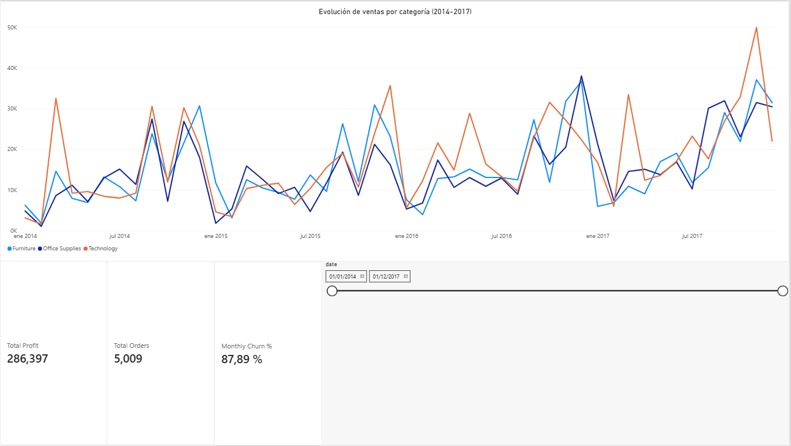

# Superstore: Rentabilidad, Descuentos y Riesgo de Clientes con SQL


## ¿Qué problema resuelve?
Una empresa minorista necesita saber **dónde gana y dónde pierde plata, qué clientes está por perder y qué productos conviene vender juntos**. Este proyecto responde esas preguntas con SQL (MySQL) sobre el dataset Superstore de Kaggle (9.994 líneas de venta, 5.009 pedidos y 793 clientes entre 2014 y 2017) y las integra en un dashboard de Power BI.

## Qué encontré

1. **Las ventas crecieron y el margen mejoró.** Las ventas anuales pasaron de $484 mil (2014) a $733 mil (2017), un 51% más, y el margen de ganancia subió de 10,2% a 12,7%. En total son $2,30 millones vendidos y $286 mil de ganancia (margen de 12,5%).
2. **Los descuentos altos destruyen margen.** Las líneas de venta con descuento mayor al 40% perdieron plata en el 100% de los casos (margen de -77%, unos $99,6 mil de pérdida). Entre 21% y 40% de descuento el margen es de -15%, y sin descuento es de +29,5%. Dentro del 5% de productos con descuento promedio más alto (95 productos), 73 operan con pérdida: acumulan -$26,8 mil sobre $87,1 mil vendidos.
3. **Muebles es la categoría débil.** Tiene un margen de 2,5%, contra 17,0% en Suministros de oficina y 17,4% en Tecnología, a pesar de vender un volumen similar.
4. **La demanda es muy estacional.** Septiembre a diciembre concentran el 52% de las ventas. Noviembre de 2017 fue el mejor mes ($118 mil), pero con un margen de 8,2%, menor al promedio, lo que sugiere descuentos de temporada.
5. **El abandono mensual no discrimina.** En promedio, 88% de los clientes que compran en un mes no compran al siguiente. Con una mediana de 6 pedidos por cliente en cuatro años, no comprar un mes es lo normal y no una señal de pérdida (ver Limitaciones).
6. **El score de riesgo identifica clientes de poco valor.** De 793 clientes, 32 quedan en riesgo alto, 343 en medio y 418 en bajo. Los de riesgo alto representan apenas el 0,4% de las ventas. Además, 357 clientes (45%) llevan más de 90 días sin comprar al cierre del dataset.
7. **Hay oportunidad de venta cruzada.** Aglutinantes (Binders) y Papel (Paper) es el par más frecuente: aparecen juntos en 275 pedidos, el 5,5% del total y el 11,7% de los 2.346 pedidos con más de una subcategoría. Le siguen Aglutinantes con Teléfonos y con Almacenamiento (199 pedidos cada uno).

## Preguntas de negocio y consultas

| Pregunta | Consulta |
|---|---|
| ¿Cómo evolucionan las ventas y el margen mes a mes? | `01_basic_monthly_sales.sql` |
| ¿Cuáles son los productos estrella de cada categoría? | `02_basic_top_products.sql` |
| ¿Qué clientes crecen más del 20% mensual? | `03_basic_customer_growth.sql` |
| ¿Qué productos están en el 10% superior de ventas de su categoría? | `04_basic_sales_percentile.sql` |
| ¿Qué clientes compraron en marzo de 2017 y no volvieron en abril? | `05_advanced_churn.sql` |
| ¿Qué productos tienen descuentos anómalos y cuánto margen les cuestan? | `06_advanced_anomalous_discounts.sql` |
| ¿Qué clientes tienen mayor riesgo de abandono? | `07_advanced_risk_scoring.sql` |
| ¿Qué subcategorías se compran juntas? | `08_advanced_market_basket.sql` |
| ¿Cómo alimento un dashboard con todo lo anterior? | `09_master_query_powerbi.sql` |

## Dashboard en Power BI


El archivo `.pbix` consume la salida de la consulta maestra (exportada a `data/master_query.csv`) y muestra la evolución de las ventas mensuales por categoría (2014 a 2017), tres indicadores clave y un filtro por rango de fechas:

- **Total Profit:** ganancia total ($286.397).
- **Total Orders:** pedidos distintos (5.009), calculados con la columna `global_order_count` para no contar dos veces los pedidos que tienen varias categorías.
- **Monthly Churn %:** promedio de las tasas mensuales de abandono (87,9%).

## Cómo funciona el score de riesgo de clientes
Cada cliente suma puntos en tres dimensiones del modelo RFM (recencia, frecuencia y valor monetario):

| Dimensión | Variable | Regla |
|---|---|---|
| **Recencia** | Días desde la última compra (respecto de la última fecha del dataset) | Más de 90 días: 50 puntos · De 31 a 90: 20 puntos · 30 o menos: 0 |
| **Frecuencia** | Cantidad de pedidos | 1 pedido: 30 puntos · 2 pedidos: 10 puntos · 3 o más: 0 |
| **Monetario** | Venta promedio por línea de pedido | Menos de $50: 20 puntos |

Clasificación: `ALTO` (más de 60 puntos) · `MEDIO` (de 30 a 60) · `BAJO` (menos de 30).

Es un score de reglas definido por criterio de negocio, no un modelo estadístico calibrado. Los umbrales son ajustables y convendría validarlos contra comportamiento real de recompra.

## Limitaciones
- **Definición de abandono.** Se considera abandono no comprar en el mes siguiente. Como los clientes de este dataset compran de forma espaciada, la métrica da tasas cercanas al 88% todos los meses y no distingue a quien se fue de quien simplemente compra con menos frecuencia. Una versión más útil usaría una ventana de inactividad más larga (por ejemplo, 90 días sin comprar). La consulta maestra excluye diciembre de 2017, el último mes del dataset, porque no tiene mes siguiente con el cual comparar.
- **Umbrales del score.** Los puntos de corte (90 días, 1 pedido, $50) son decisiones propias, sin calibrar contra datos observados.
- **Alcance de la consulta de abandono individual.** `05_advanced_churn.sql` analiza un solo par de meses (marzo a abril de 2017); la consulta maestra calcula el abandono para todos los meses.
- **Dos definiciones de producto en alerta.** `06_advanced_anomalous_discounts.sql` calcula el percentil de descuento sobre todos los productos (95 productos); la consulta maestra lo calcula dentro de cada categoría (89 productos en total), para poder comparar categorías.
- **Dataset de ejemplo.** Es público y no refleja una operación real, por lo que los hallazgos son demostrativos.

## Técnicas de SQL utilizadas
- **Funciones de ventana:** `LAG()`, `RANK()`, `PERCENT_RANK()` con `PARTITION BY`
- **CTE encadenadas:** hasta 4 etapas en el score de riesgo y 5 en la consulta maestra
- **Joins:** autojoin para pares de subcategorías, `LEFT JOIN ... IS NULL` para detectar ausencia de compra
- **Fechas y lógica condicional:** `DATE_FORMAT`, `DATEDIFF`, `INTERVAL 1 MONTH`, `CASE WHEN`

## Estructura del repositorio
```
superstore-sql-analysis/
├── README.md
├── queries/
│   ├── 00_setup_ventas.sql
│   ├── 01_basic_monthly_sales.sql
│   ├── 02_basic_top_products.sql
│   ├── 03_basic_customer_growth.sql
│   ├── 04_basic_sales_percentile.sql
│   ├── 05_advanced_churn.sql
│   ├── 06_advanced_anomalous_discounts.sql
│   ├── 07_advanced_risk_scoring.sql
│   ├── 08_advanced_market_basket.sql
│   └── 09_master_query_powerbi.sql
├── data/
│   ├── Sample_Superstore.csv
│   └── master_query.csv
├── img/
│   └── dashboard_screenshot.png
└── dashboard/
    └── SUPERSTORE_SQL.pbix
```

## Datos
**Fuente:** [Kaggle: Sample Superstore](https://www.kaggle.com/datasets/vivek468/superstore-dataset-final)

Columnas principales: `Order ID`, `Customer ID`, `Product Name`, `Category`, `Sub-Category`, `Sales`, `Profit`, `Discount`, `Quantity`, `Order Date`, `State`.

## Cómo reproducirlo
1. Importar `data/Sample_Superstore.csv` en MySQL 8.0 (base `superstore`, tabla `ventas`), dejando `Order Date` como texto (`VARCHAR`, formato m/d/yyyy) y usando la codificación `windows-1252`.
2. Ejecutar `queries/00_setup_ventas.sql`, que agrega a `ventas` la columna `order_date_formatted` (fecha convertida desde `Order Date`) y verifica que haya 9.994 filas sin fechas nulas.
3. Ejecutar el resto de las consultas de `queries/` en orden.
4. Para el dashboard, abrir `dashboard/SUPERSTORE_SQL.pbix`. Si querés regenerar los datos, exportá a CSV el resultado de `09_master_query_powerbi.sql` (por ejemplo, desde DBeaver) y cargalo en Power BI, con configuración regional en inglés (EE. UU.) para que lea bien los decimales.

> Nota: el `.pbix` guarda los datos ya cargados, pero si lo abrís en otra computadora y apretás **Actualizar**, tenés que apuntar el origen a tu copia de `data/master_query.csv`.

## Autor
**Facundo Spolita**
[LinkedIn](https://linkedin.com/in/facundospolita) · [GitHub](https://github.com/facundospolita)
